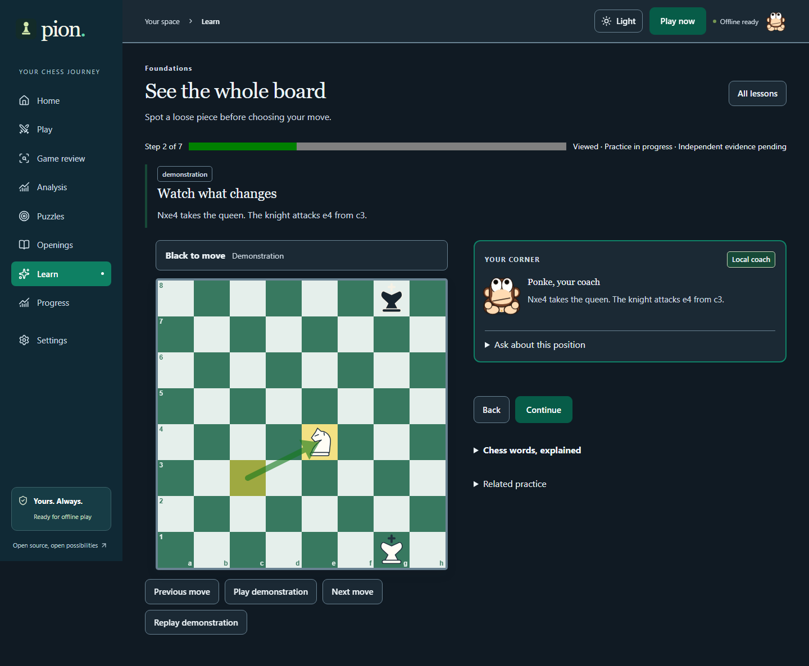
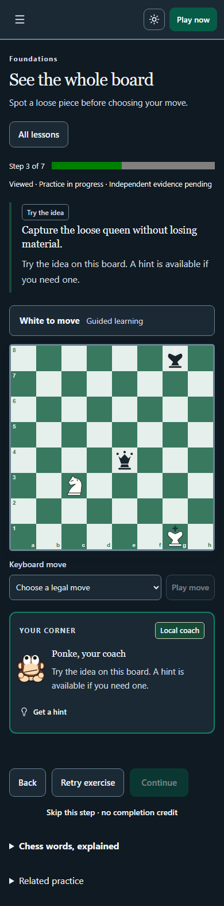

# Learning release validation — 2026-10-15

| Scenario | Verification |
|---|---|
| A: Learn through mistakes | Board vision, legal queen refutation, progressive hint, exact-step reload, board/choice work and separate fresh unaided transfer. |
| B: Understand an opening | Italian search, specific f7/development commentary, variation switch, replay, save and short recall. |
| C: Different legal move | Studied/book/engine-compared alternatives, retry/continue without automatic blunder labels; both learner colors tested. |
| D: Personal learning | Two actual Stockfish reviews reveal recurring king-safety losses; Home links matching lesson, independent exercise and mate-in-one puzzles. |
| E: Fully offline | After cache readiness, disable network and visit new routes; complete/resume lesson, recall Black repertoire, compare master decision with Stockfish and solve puzzle. |
| Rated integrity | All practice options on; rated match hides assistance, receives bot reply, blocks active review, saves result and unlocks review. |
| Master study | Legal alternative, attributed historical choice, actual Stockfish comparison, replay and related lesson. Fourteen complete scores and content/source links validated. |
| Data preservation | V1/V6→V7 fixtures and backups preserve histories, ratings, repertoire, study steps/hints, attempts and schedules. Invalid data rejected transactionally. |

M6 full workflow passed source 0bd177f3f0cf214aaec96f542338faeb077099a7: [Ubuntu run 38530648125](https://github.com/0xAldoLim/pion/actions/runs/38530648125).

M7 targeted rated/practice/classification workflows: six desktop/mobile scenarios passed. Learning/master/offline workflows: eight desktop/mobile scenarios passed, including both-palette master-study WCAG scans. Splitting exposed a base-CSS ordering regression; entry-point ordering is restored and all coordinate/frame/overflow assertions are retained.

The final suite contains 120 scenarios in 11 browser files across Chromium desktop, Pixel 7 Chromium emulation and Firefox. Final source/run, counts and visual evidence will be appended after validation completes.

Automated checks establish legal positions, specified objectives, actual interaction and evidence accounting. They do not prove general skill acquisition. Mirrored diagrams, short lessons, historical decisions and bounded searches have limited scope. No lesson-count mastery, fabricated statistics, exact bot Elo, GM quotations or proprietary scoring parity is claimed. See KNOWN_ISSUES.md.

## Local release verification

- TypeScript, ESLint and production build pass. Vitest: 20 files / 110 checks pass. License inventory: 464 dependencies, zero unknown declarations. Registry advisory snapshot: zero known vulnerabilities at all severities; this is not proof of absence.
- Twenty affected desktop/mobile scenarios pass across learning, master/offline, rated/practice/classification and all six geometry/dialog/active-frame scenarios. The rated test follows the actual assigned color. No old assertion was relaxed.
- Dedicated visual run: 39 layout states / 39 Axe scans, zero overflow findings and zero WCAG 2 A/AA or 2.1 AA violations. Includes all nine main routes in both palettes, lesson demonstrations, Italian detail, master decisions and 320/390/768 px new learning/explorer/repertoire views. Raw findings: LEARNING_VISUAL_AUDIT.json.
- Visual inspection checked actual piece assets, coordinate labels, board frame, arrows, current objective, compact coach disclosure and mobile flow. Captures were returned to document top before full-page export so sticky navigation is framed correctly.
- Production build: main JS 76.85 KB gzip; 104 precache entries / 5242.19 KiB. Full optional engine remains excluded from automatic precache.

Final evidence-grounding audit: a general back-rank observation about the next side to move is no longer treated as the mover’s king-safety error. King-safety recommendations require a concrete mating threat or a verified losing mate score. Tactical-threat recommendations inspect the opponent’s actual legal searched reply instead of a motif created by the learner. Two regression checks replay the relevant board facts and a legal knight fork; reviewed-game workflows are revalidated.

## Full-matrix follow-up

Source ddf9ba20ff1d60bf70a8650483990d240029daeb, Ubuntu run 38661300173: 118/120 browser scenarios passed. The two diagnostics showed an early empty character query during lazy route loading and a Firefox route stuck at the Suspense placeholder because the test froze UI timers before the transition. The character test now waits for all twelve profiles before checking the same seven identities. The premove test finishes route setup before freezing time, still checks every original queue/history/cancellation assertion, and additionally waits for the saved active history after restoring the preference. Route helpers wait for the actual heading. Twelve repeated desktop/mobile runs pass. No scenario, assertion, project or retry policy was removed.
